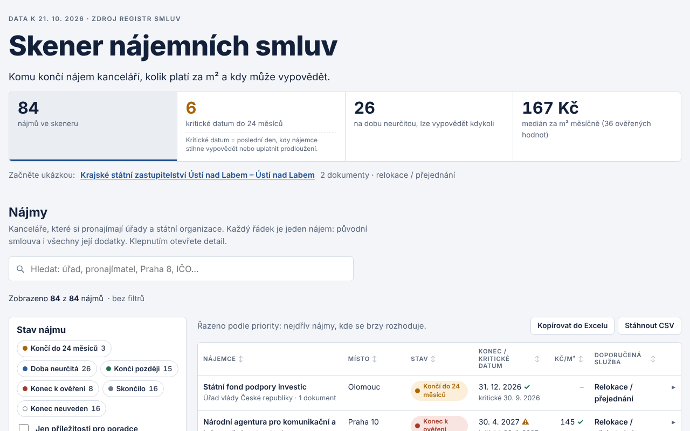
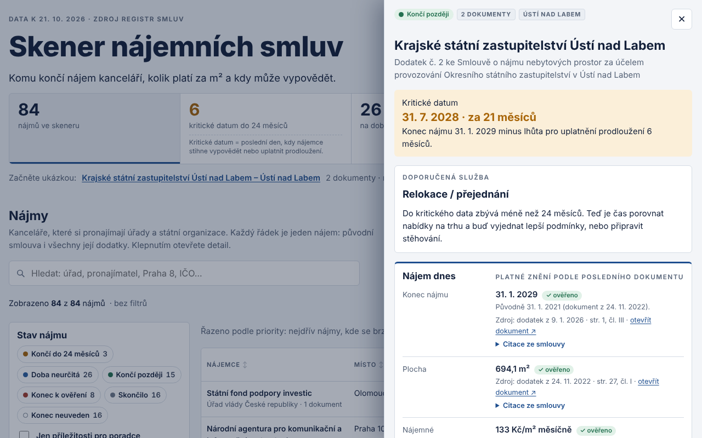

# Skener nájemních smluv

**Komu končí nájem kanceláří, kolik platí za m² a kdy může vypovědět.**

👉 **Živé demo: [tataboj.github.io/skener-najemnich-smluv](https://tataboj.github.io/skener-najemnich-smluv/)** – otevře se v prohlížeči, nic se neinstaluje.

[](https://tataboj.github.io/skener-najemnich-smluv/)

Ukázkový projekt pro realitní poradenství: z otevřených dat [Registru smluv](https://smlouvy.gov.cz/) najde
nájmy kanceláří, které si pronajímají úřady a státní organizace, přečte smlouvy i jejich dodatky a u každého
nájmu ukáže, kdy se nájemce bude rozhodovat, jestli zůstane, nebo se stěhuje.

## Co demo umí

| | |
|---|---|
| **Nájem dnes** | Smlouva + všechny dodatky jako jeden nájem. Platná hodnota z nejnovějšího dokumentu i co platilo původně. |
| **Kritické datum** | Konec nájmu minus výpovědní lhůta nebo lhůta pro uplatnění prodloužení. Kalendář na 36 měsíců. |
| **Doporučená služba** | Relokace / přejednání, přejednání (doba neurčitá), optimalizace (zmenšování), expanze. |
| **✓ ověřeno / ⚠ zkontrolovat** | Každý údaj má citaci ze smlouvy se stranou a článkem. ✓ jen tehdy, když citace obsahuje přesně tuto hodnotu. |
| **Práce s daty** | Hledání s našeptávačem, filtry, mapa obvodů Prahy, cena za m², kopírování do Excelu. |

[](https://tataboj.github.io/skener-najemnich-smluv/)

## Jak to funguje

```
Registr smluv (8,8 mil. záznamů, 2018–2026)
  → výběr nájmů nebytových prostor (69 229)
  → úřad jako nájemce, kanceláře (300)            ARES, pravidla
  → texty smluv a dodatků s čísly stran           PDF / Word, metadata XML registru
  → dva nezávislé extraktory                      pravidla + lokální LLM (Ollama, qwen3:4b-instruct)
  → ověření citací, řetězec smlouva → dodatky
  → 84 nájmů ze 149 dokumentů → statická HTML stránka
```

- **Lokální model, žádný cloud:** jazykový model běží na obyčejném notebooku bez GPU (i5, 16 GB RAM).
  Demo samotné model nepotřebuje – výsledky jsou vložené ve stránce.
- **Model se nekontroluje sám:** pravidla a model čtou smlouvu nezávisle. Hodnota bez doslovné opory
  v textu dostane ⚠, rozpor obou metod se ukáže jako dvě hodnoty.
- **Dodatky:** metadata registru (`navazanyZaznam`) spojují dodatek s původní smlouvou. Bez toho by byl
  konec nájmu zhruba u každé páté smlouvy špatně.
- **Osobní údaje:** jména pronajímatelů, kteří jsou fyzické osoby, se nezobrazují ani v citacích.

## Spuštění pipeline (Windows, PowerShell)

Pro prohlížení dema nic z toho potřeba není. Toto je jen pro přepočítání dat.

```powershell
Set-ExecutionPolicy -Scope Process -ExecutionPolicy Bypass -Force
.\install.ps1
.\run.ps1 krok1 --od 2018-01 --ano     # měsíční dumpy registru -> kandidáti nájmů
.\run.ps1 krok2 ares --praha           # role stran podle ARES
.\run.ps1 krok2b vyber --praha         # výběr kancelářských nájmů státu
.\run.ps1 krok2b pdf                   # texty smluv (PDF + Word)
.\run.ps1 krok3 vse                    # lokální model: role + abstrakt (vyžaduje Ollama)
.\run.ps1 krok5                        # metadata XML: dodatky, přílohy, texty s čísly stran
.\run.ps1 demo                         # data\demo\skener-najemnich-smluv.html
```

Krok 3 potřebuje [Ollama](https://ollama.com) s modelem `qwen3:4b-instruct`; na CPU trvá ~2,5 min na smlouvu,
na GPU jednotky sekund.

## Testy

- `python -m pytest -q tests` – pravidla, ověření citací, řetězce dodatků, kritické datum, anonymizace.
- `node tests/prohlizec/tester.js index.html` – automatický tester v prohlížeči (Playwright, 684 kontrol):
  každé tlačítko, dlaždice a položka našeptávače (číslo = počet řádků), detail všech nájmů (tvar odkazů),
  šířky 1280–360 px, světlý i tmavý režim, chyby v konzoli.

## Omezení

- Pokrývá veřejný sektor (nájemcem je úřad), ne celý trh. Smlouvy starší než registr (2016) chybí.
- Skeny bez textové vrstvy model nepřečte. Plocha v dodatku může popisovat jen měněnou část prostor.
- Údaje ⚠ je nutné ověřit ve smlouvě – odkaz na dokument je u každého údaje.

## Autor

Michael Klimeš · [LinkedIn](https://www.linkedin.com/in/michael-klimes) · postaveno s pomocí AI (Claude) jako ukázka práce.

Data: Registr smluv (smlouvy.gov.cz), ARES. Kód pod licencí MIT.
